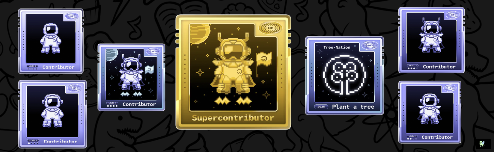

# Hi there 👋, I'm Himanshu Bansal

<h1 align="center">Hi there 👋,   I'm Himanshu Bansal</h1>

  💻 Second-Year B.Tech CSE (AI/ML) Student  
  🚀 Aspiring Full Stack Developer | Problem Solver

---

## 🧑‍💻 About Me

- 🎓 Pursuing B.Tech in Computer Science (AI & ML) at NST-ADYPU
- 💻 Aspiring Full Stack Developer
- 🛠️ Passionate about building projects and exploring new technologies
- 📚 Continuously learning and improving my development skills
- 📫 Reach me at: **[reach.himanshu1803@gmail.com](mailto:reach.himanshu1803@gmail.com)**

---

## 🚀 Tech Stack

### Languages

### Frontend

### Mobile Development

### Backend & Database

### Automation & Workflows

### Tools & Frameworks

---

## 🏆 Achievements & Contributions

  

---

## 📊 GitHub Stats

  
  

---

## 📌 Featured Projects

- 🛒 **Mini E-Commerce Website** — An online shopping interface.
- 🔐 **HireAI — Resume Screening Platform** — A project focused on resume screening and evaluation.
- 🎬 **CineWatch** — A movie watchlist application.

[Explore all my repositories →](https://github.com/Himanshubansal-2008?tab=repositories)

---

## 🧩 Coding Profiles

  
  

---

## 🌐 Connect With Me

  <a href="https://www.linkedin.com/in/himanshu-bansal-9bb973376">LinkedIn</a> •
  <a href="mailto:reach.himanshu1803@gmail.com">Email</a> •
  <a href="https://github.com/Himanshubansal-2008">GitHub</a>

---

  ⭐️ <i>Code. Learn. Build. Repeat.</i>

